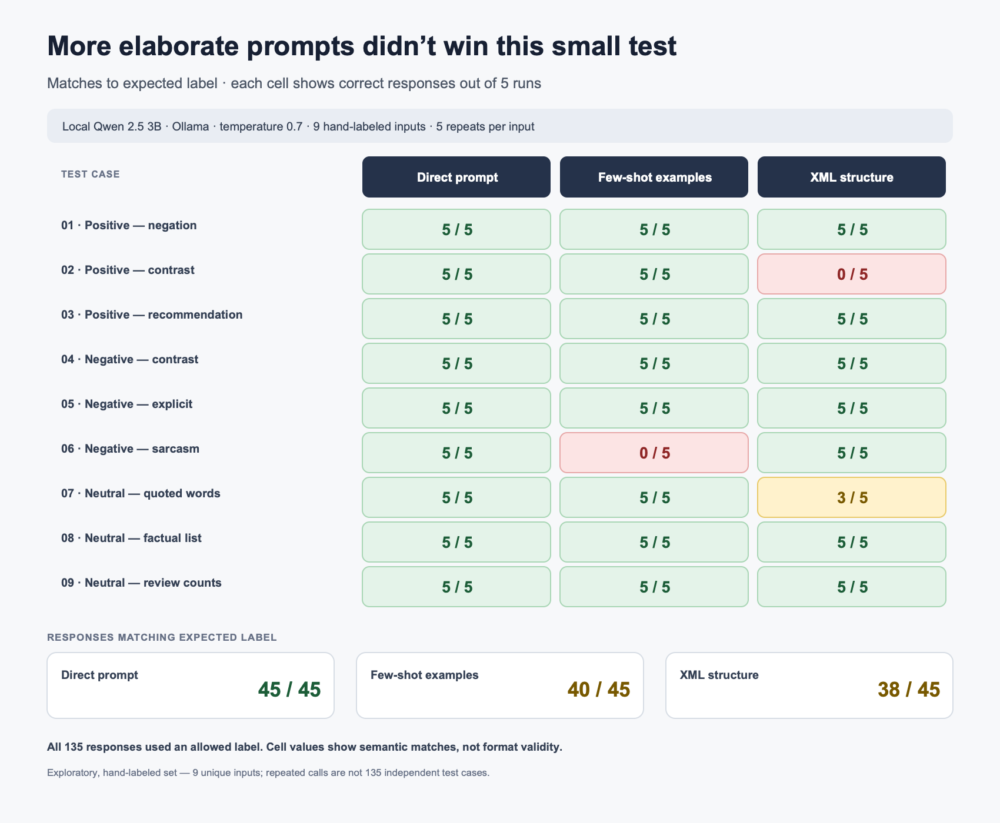

# LLM Playground: prompt consistency

A small Java 17+ experiment that sends one sentiment-classification task to a
chat-completions endpoint 20 times for each of three prompt styles. It supports
local Ollama and remote providers that use the OpenAI-compatible request and
response format:

1. Direct instructions, no examples.
2. Few-shot instructions with examples.
3. Instructions arranged in XML-like tags.

The script records the prompt, each raw response, its normalized form, and
per-prompt consistency statistics in `results.json`. It writes after every
successful request, so results from completed calls remain available if a
later request fails. It does not retry failed calls or log the API key.

## Run

Requires a JDK 17+ (the source uses Java records) and no third-party Java
libraries.

### Local Ollama

Start the Ollama app/server, then download the model:

```sh
ollama pull qwen2.5:3b
```

The local Ollama endpoint ignores API authentication, but this program requires
a non-empty `LLM_API_KEY`, so use the placeholder value `ollama`:

```sh
export LLM_API_KEY="ollama"
export LLM_API_URL="http://localhost:11434/v1/chat/completions"
export LLM_MODEL="qwen2.5:3b"
export LLM_TEMPERATURE="0.7"
```

Optionally set `LLM_TEXT` to evaluate a different input without editing or
recompiling the source:

```sh
export LLM_TEXT="The app did not disappoint; it works flawlessly."
```

### Compile and run

```sh
mkdir -p out
javac -d out src/main/java/dev/llmplayground/*.java
java -cp out dev.llmplayground.Main results.json 2
```

The example runs two calls per prompt (six calls total). To run the full
experiment with 20 calls per prompt (60 total):

```sh
java -cp out dev.llmplayground.Main results.json 20
```

The first optional argument is the output path and the second is the number of
runs per prompt. Omitting both uses `results.json` and 20 runs per prompt.

### Other OpenAI-compatible providers

Set the provider's API key in your shell; do not put credentials in this
repository. The defaults are shown below:

```sh
export LLM_API_KEY="your-api-key"
export LLM_API_URL="https://api.openai.com/v1/chat/completions"
export LLM_MODEL="gpt-4o-mini"
export LLM_TEMPERATURE="0.7"
```

`LLM_API_URL` can point to another provider implementing the OpenAI chat
completions request/response shape. Check that the selected model accepts the
configured temperature. Requests are sequential to keep the run order easy to
inspect. Cloud-provider runs can incur API costs.

## Reading the results

Each experiment includes:

- `rawOutput`: exact text returned by the model.
- `normalizedOutput`: lowercase, trimmed output with surrounding punctuation
  removed; the interior is preserved.
- `validLabel`: whether the normalized output is exactly one of the three
  allowed labels.
- `outputCounts` / `labelCounts`: observed frequencies.
- `consistencyRate`: largest exact normalized-output bucket divided by all
  completed runs. It is not a measure of correctness.
- `validLabelRate`: fraction of runs that followed the output contract.

Compare all three prompt variants using the same model, temperature, text, and
run count. A single run is not enough to conclude one prompt is more reliable.
The output JSON contains observations from the actual run; no result is
pre-filled or assumed.

## Five output checks beyond `assertEquals`

1. **Contract/schema check:** every response is one allowed label with no
   explanation or extra fields.
2. **Semantic check:** label agrees with a human-reviewed expected sentiment,
   or with a documented rubric for ambiguous cases.
3. **Property/invariant check:** outputs always belong to the allowed label
   set, independent of exact wording inside that set.
4. **Metamorphic check:** apply a meaning-preserving paraphrase to the input
   and check that the label remains stable; separately, reverse sentiment and
   check that the label changes accordingly.
5. **Statistical consistency check:** across repeated calls, track valid-label
   rate, label distribution, distinct outputs, and the most-common-output
   rate. Set an acceptable threshold from a baseline rather than expecting
   every response to match exactly.

## Results

### Initial one-input pilot

In an initial local run with `qwen2.5:3b` through Ollama at temperature `0.7`,
all three prompt styles returned `positive` in all 20 calls for one clearly
positive input. This showed repeatability on that input, not general accuracy
or determinism.

### Challenge-set run



The challenge run used the same local model and temperature, with 9
hand-labeled inputs, 3 prompt styles, and 5 repetitions per input (135 calls).
All responses used an allowed label. Matches to the expected labels were:

| Prompt style | Expected-label matches | Valid-label outputs |
| --- | ---: | ---: |
| Direct prompt | 45/45 | 45/45 |
| Few-shot examples | 40/45 | 45/45 |
| XML structure | 38/45 | 45/45 |

These failure cases stood out:

- The few-shot prompt did not handle the sarcastic negative text
  “Fantastic, another update erased my settings. Exactly what I wanted.”
  consistently: it returned `positive` four times and `neutral` once.
- The XML prompt labeled the positive contrast case
  “The setup was frustrating, but once installed the device has been excellent
  and I am delighted with the result.” as `negative` in all five calls.
- On the neutral text containing the quoted words “excellent” and “terrible,”
  the XML prompt returned `negative` twice and `neutral` three times.

On this small set, the direct prompt matched the expected label most often.
This does not show that direct prompts are generally better: the set has only
9 unique inputs, the labels are hand-assigned, and the prompt templates differ
in wording as well as examples or markup. Repeated calls measure repeatability
for these inputs; they do not add new test scenarios.

The challenge inputs and expected labels are listed below so the run can be
repeated:

| ID | Expected label | Input |
| --- | --- | --- |
| 01 | `positive` | The app did not disappoint: setup took two minutes, and every feature has worked flawlessly. |
| 02 | `positive` | The setup was frustrating, but once installed the device has been excellent and I am delighted with the result. |
| 03 | `positive` | I would not hesitate to recommend this service; the team resolved my issue on the first call. |
| 04 | `negative` | The screen looks beautiful, but the laptop crashes every time I save and support has ignored me. |
| 05 | `negative` | I cannot recommend this service: it missed the deadline and never answered my emails. |
| 06 | `negative` | Fantastic, another update erased my settings. Exactly what I wanted. |
| 07 | `neutral` | The report contains the words 'excellent' and 'terrible' as examples, but it does not evaluate any product or service. |
| 08 | `neutral` | The shipment contains one blue notebook, two pens, and a charging cable. |
| 09 | `neutral` | The report lists five positive reviews and three negative reviews, without assigning an overall rating. |

These are exploratory results for one model and one sampling setting, not a
general benchmark. The prompt comparison also does not isolate the effect of
XML formatting from other wording differences.
